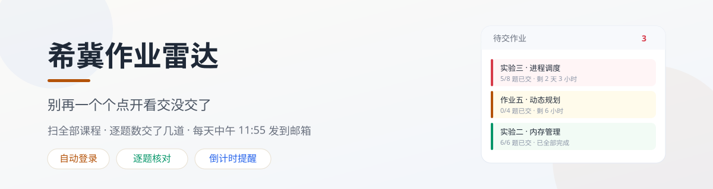
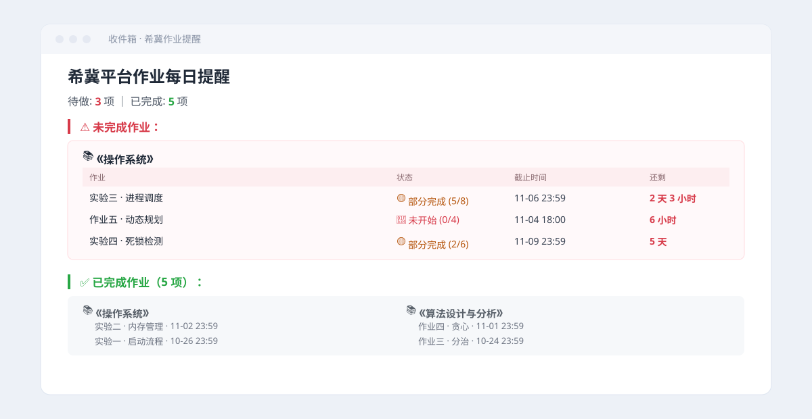
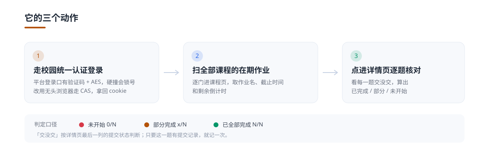

# 希冀作业雷达 (cstlab Assignment Radar)

<p align="center">
  
</p>

<p align="center">
  
  
  
  
  
</p>

<p align="center">
  <b>每天中午 11:55，把「哪门课还剩什么作业、交了几题、还有多久截止」整理成一封邮件</b><br>
  扫全部课程，逐个作业点进去核题，未做完的排在最上面。
</p>

<p align="center"></p>

---

## 项目背景

希冀（CourseGrading）的作业列表只会告诉你「有这么一个作业」，不会告诉你「这门课你还差三题没交」。要知道这个，得一个个点进详情页翻。

一学期七八门课，靠脑子记截止时间，迟早翻车。真正需要的其实只有一件事：每天早上看一眼，今天必须先做哪个。

| 痛点 | 场景描述 | 本项目的解法 |
| --- | --- | --- |
| 作业散在各门课 | 每门课一个列表，凑不出全局视图 | 一次扫完全部课程的在期作业 |
| 只看到作业名 | 不知道这门课交了几题、还差几题 | 点进详情页逐题核对，给出 x/N |
| 截止时间靠记 | 记错一次就是零分 | 抓精确截止时间与剩余倒计时 |
| 不知道还来不来得及 | 列表页的时间常常只显示日期 | 邮件里直接写「还剩 2 天 3 小时」 |
| 做完的混在没做的里 | 一堆作业看不出轻重 | 未完成的排上面，已完成的收在下面 |

---

## 核心功能

**1. 走校园统一认证登录**
- 平台自带的登录口有图形验证码，密码还过了一层加密，硬撞容易风控锁号；
- 改用无头浏览器走学校 CAS，像人一样填学号密码、点登录；
- 拿到 `JSESSIONID` 后切回普通请求，后面的抓取又快又稳。

**2. 扫全部课程**
- 自动枚举课程列表，逐门取在期作业；
- 提取作业名、精确截止时间、剩余倒计时、直达链接。

**3. 逐题核对提交状态**
- 进每个作业的详情页，按提交状态逐行统计；
- 判定三档：已全部完成 N/N、部分完成 x/N、未开始 0/N。

**4. 一封看得懂的邮件**
- 未完成的排最上面，带倒计时；
- 已完成的收在下面，只列名字，一眼扫过。

---

## 效果预览

<p align="center">
  
</p>

没做完的排在最上面，带倒计时；做完的收在下面。扫一眼就知道今天必须先做哪个。

---

## 工作原理

<p align="center">
  
</p>

### 为什么不用普通请求直接登录

平台的登录口有图形验证码，密码还做了一层加密，脚本硬撞几次就会被锁号。所以这里绕开它，走学校自己的 CAS 统一认证：用一个看不见的浏览器，把学号和密码填进去、点登录，拿到会话 cookie 之后再换回普通请求。

这不是耍花招，只是平台的风控本来就是防「用脚本撞密码」的。你登的是自己的账号，看的是自己的作业，一天跑一次。

---

## 快速开始

### 第 0 步：准备邮箱（QQ 邮箱免费）

**QQ 邮箱注册免费，SMTP 服务也不收费**，个人每天发一封的量远远用不完。企业邮箱才涉及付费，这里用不上。

- 邮箱注册：<https://mail.qq.com/> 点「注册新账号」，或走 QQ 账号注册页 <https://ssl.zc.qq.com/v3/index-chs.html>
- **开启 SMTP 服务（这一步是关键）**：登录 QQ 邮箱 → 设置 → 账号 → 找到「POP3/IMAP/SMTP 服务」→ 开启 → 按提示验证 → 拿到 16 位授权码
- 图文步骤看官方帮助：<https://service.mail.qq.com/detail/0/75>

### 第 1 步：拿代码并装依赖

```bash
git clone https://github.com/xm2284/cstlab-assignment-radar.git
cd cstlab-assignment-radar

pip install -r requirements.txt
playwright install chromium
```

国内打不开 GitHub 用镜像：`https://gitee.com/xm2284/cstlab-assignment-radar.git`

> `playwright install chromium` 必须跑，否则报找不到浏览器。这一步要下载约 150MB。

### 第 2 步：填配置

```bash
cp config.example.json config.json
```

```json
{
  "stid": "你的学号",
  "pwd": "你的校园密码",
  "email": {
    "smtp_server": "smtp.qq.com",
    "smtp_port": 465,
    "sender": "你的QQ号@qq.com",
    "auth_code": "QQ邮箱SMTP授权码",
    "receiver": "你的QQ号@qq.com"
  }
}
```

`config.json` 已在 `.gitignore` 里，不会被提交。**别把它传到任何公开仓库。**

### 第 3 步：跑起来

```bash
python xiji_assignment_radar.py
```

正常会看到三段输出：

```
[1/3] 启动无头浏览器，走校园统一认证…
  统一认证通过
[2/3] 逐门扫描在期作业…
  · 操作系统：3 项
  · 算法设计与分析：2 项
[3/3] 生成并投递邮件…
  已发送：待做 3 项，已完成 5 项
```

### 第 4 步：挂定时任务

Windows，每天 11:55：

```powershell
schtasks /create /tn "作业雷达" /tr "pythonw.exe D:\radar\xiji_assignment_radar.py" /sc daily /st 11:55
```

Linux / macOS：

```bash
crontab -e
55 11 * * * /usr/bin/python3 /home/you/cstlab-assignment-radar/xiji_assignment_radar.py >> /tmp/xiji.log 2>&1
```

---

## 工程结构

```
cstlab-assignment-radar/
├── xiji_assignment_radar.py    # 主程序，单文件
├── config.example.json         # 配置模板（复制成 config.json 再填）
├── requirements.txt
├── assets/
│   ├── hero.svg
│   ├── flow.svg
│   ├── mail.svg
│   └── divider.svg
├── LICENSE
├── .gitignore
└── README.md
```

---

## 安全与隐私

- 登录的是你自己的账号，读取的是你自己的作业数据；
- 密码只存在本地 `config.json`，该文件已被 `.gitignore` 忽略；
- 只读不写：不提交作业、不改答案、不做任何写操作；
- 一天跑一次，不并发、不批量请求，不对平台造成压力。

---

## 常见问题

**第一次跑就报证书错误？**
校园站的证书链经常不完整。脚本里已经带了 `--ignore-certificate-errors`，自己改启动参数时别把这个丢掉。这也是这个项目第一次跑失败的真正原因。

**提示「登录异常，没拿到 JSESSIONID」？**
三种可能：密码改了；账号被风控临时限制，等一会儿再试；学校换了登录页结构，输入框的 `placeholder` 变了，改 `page.locator(...)` 那两行就行。

**扫出来 0 项？**
平台改版，`div.main-zy`、`p.main-title` 这类选择器失效了。把作业列表页的 HTML 存一份，跟 AI 说「这是列表页，要作业名、截止时间、倒计时、链接」，让它改 `parse_course_assigns`。

**状态判断不准？**
详情页的提交状态文案各地不同。`check_assignment_detail_status` 里认的是「已提交 / 通过 / 已评阅」，你们平台如果用别的词，加进那个列表。

**会不会锁号？**
一天一次，走的是正常登录流程，和人手动登一次没区别。别把定时任务设成几分钟跑一次。

---

## 联系作者

- QQ：`2284517861`（小明同学）
- GitHub：[xm2284](https://github.com/xm2284)
- Gitee 镜像：[gitee.com/xm2284/cstlab-assignment-radar](https://gitee.com/xm2284/cstlab-assignment-radar)

---

## 免责声明

1. 本项目为个人自用的自动化工具，与学校及希冀平台无隶属或合作关系；
2. 仅登录本人账号读取本人作业数据，不爬取他人信息、不做任何写操作；
3. 请遵守学校平台的使用条款，合理设置运行频率；
4. 学号与密码保存在本地，请自行妥善保管，勿提交到公开仓库。

---

## 开源许可证

本项目基于 [MIT License](LICENSE) 开源。
